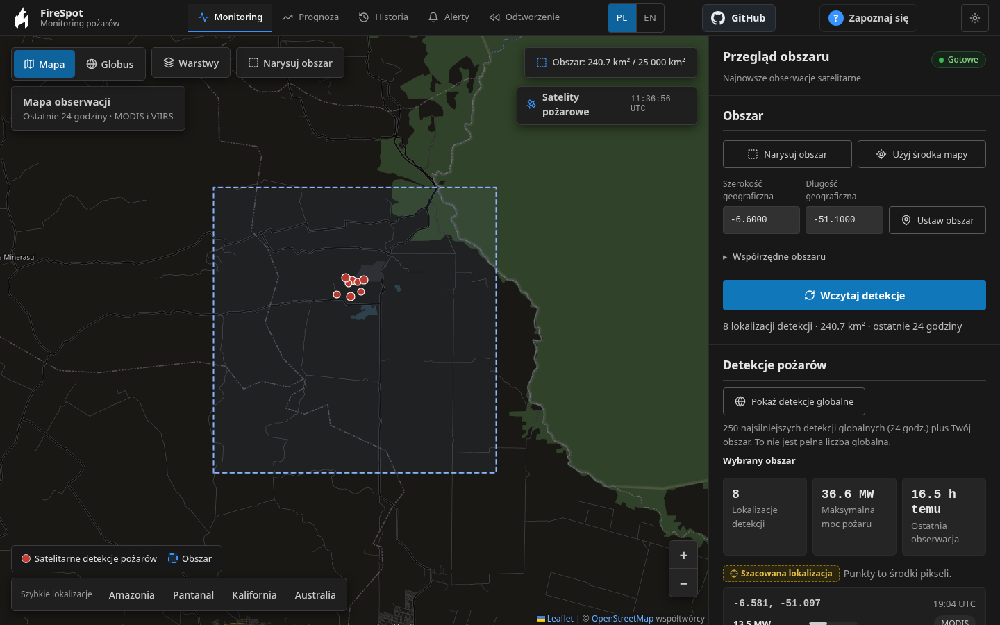
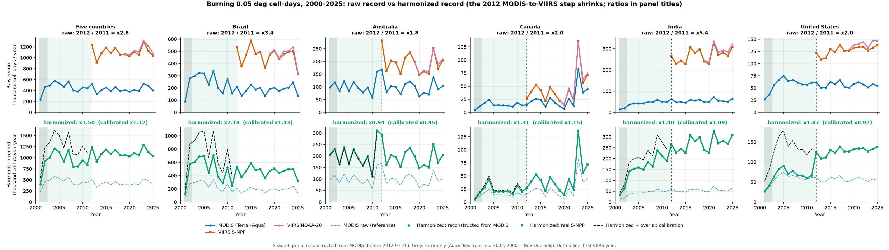
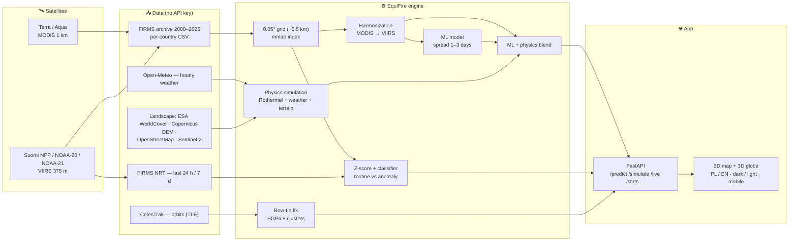
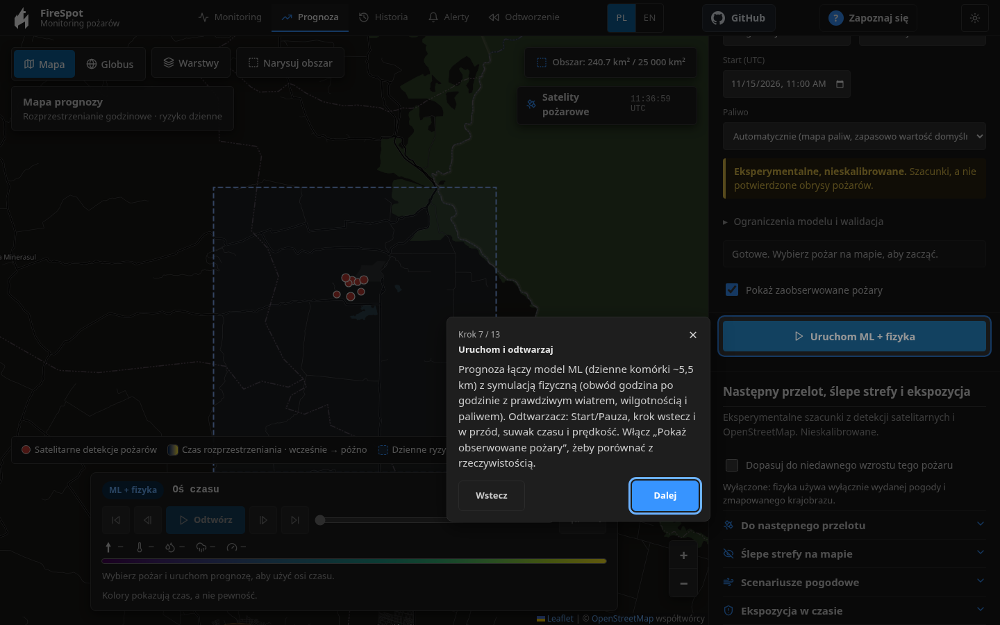
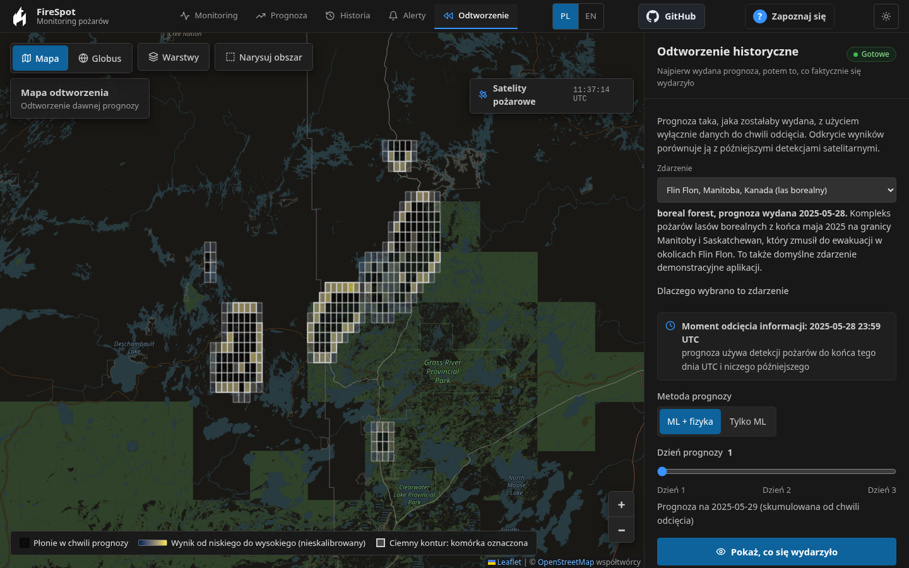
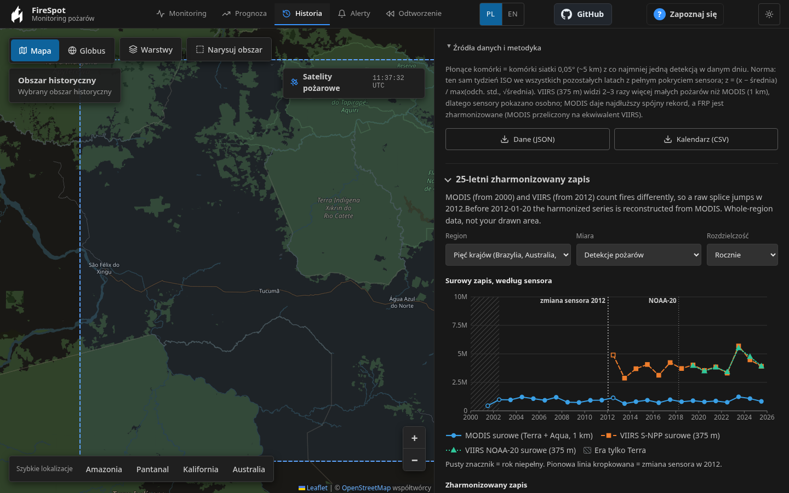
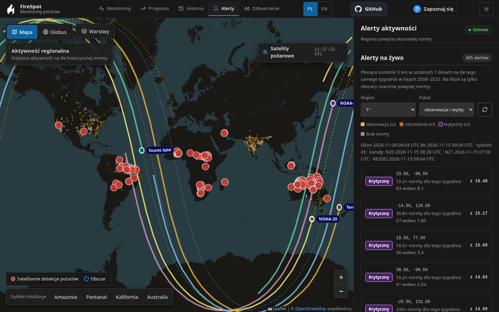
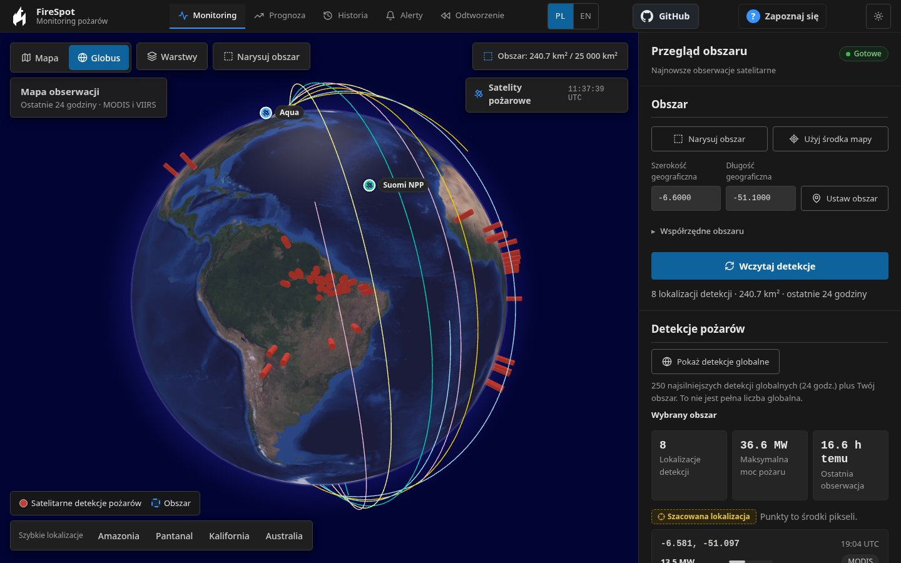
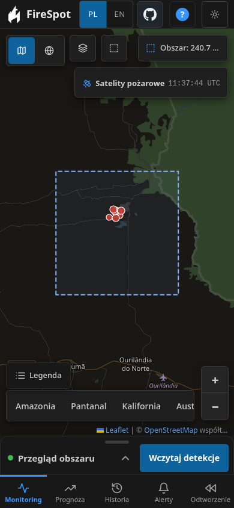
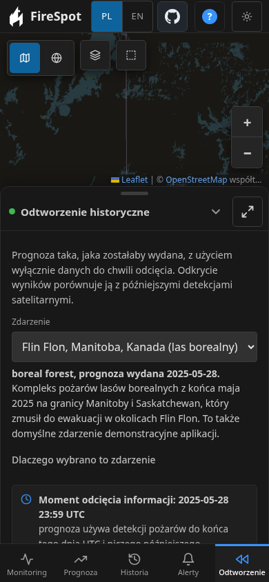

<div align="center">

# 🔥 FireSpot (EquiFire)

### Harmonizing MODIS and VIIRS fire detections, early warning and short-term spread forecasts

*NASA Space Apps Challenge 2026 — **Harmonization of MODIS and VIIRS Hot Spots***


**[🇵🇱 Polska wersja → README.md](README.md)**



</div>

> ⚠️ **Research prototype.** Results are experimental and uncalibrated. Do **not** use for operational decisions (evacuation, dispatch, insurance, life safety). Every number below comes from our own reports (`reports/`) and is documented with its limits in the [model card](docs/MODEL_CARD.md).

---

## 📑 Contents

1. [What it is](#-what-it-is)
2. [The problem: the 2012 data jump](#-the-problem-the-2012-data-jump)
3. [What we built: the 8 challenge goals](#-what-we-built-the-8-challenge-goals)
4. [Architecture](#-architecture)
5. [Web app tour](#-web-app-tour)
6. [Methods step by step](#-methods-step-by-step)
7. [Results, honestly](#-results-honestly)
8. [Quick start](#-quick-start)
9. [Data and licences](#-data-and-licences)
10. [API](#-api)
11. [Repository layout](#-repository-layout)
12. [Tests and demo](#-tests-and-demo)
13. [Limitations](#-limitations)
14. [Team, licence, credits](#-team-licence-credits)

---

## 🎯 What it is

**FireSpot** is a tool for emergency services, researchers, land managers and firefighters. It combines:

- **satellite data harmonization** — brings old MODIS (1 km, since 2000) and newer VIIRS (375 m, since 2012) measurements into one comparable 2000–2025 record,
- **live monitoring** — fires of the last 24 h on a 2D map and a 3D globe, with satellite orbits,
- **early warning** — compares current activity with the same week in 2008–2025 (z-score) and separates *routine burning* from *anomalies*,
- **spread forecasts** — a machine-learning model (~5.5 km cells, 1–3 days) combined with a physics simulation (hour-by-hour perimeter with wind, moisture, fuel, terrain and barriers),
- **honest validation** — "Replay": a forecast issued only from data available at its start time, compared afterwards with what satellites actually saw.

The analytics engine is **EquiFire** (`equifire/`); the application is **FireSpot** (`backend/` + `frontend/`).

---

## 🛰️ The problem: the 2012 data jump

MODIS (Terra since 2000, Aqua since 2002) has a pixel of about **1 km²**. VIIRS (Suomi NPP since 2012, NOAA-20 since 2018, NOAA-21 since 2023) has about **0.14 km²** (375 m). The same fire looks very different:

| | MODIS | VIIRS |
|---|---|---|
| Pixel at nadir | 1 km | 375 m |
| Small fire | often invisible | often visible |
| One large front | 1 point | many points |
| Fire radiative power (FRP) | averaged with background | different scale |
| Swath edge | pixel up to 2.0 × 4.8 km ("bow-tie") | similar distortion |

Result: when records are simply concatenated, detections **jump ×5.2 in 2012** and the apparent trend is **+7.7 %/year** — mostly an instrument change, not a change in fires. Our harmonization reduces the jump to **×1.16** and the trend to **+0.6 %/year (not significant)**.



---

## ✅ What we built: the 8 challenge goals

| # | Goal | What we did | Where |
|---|---|---|---|
| 1 | Spatiotemporal aggregation and FRP cross-calibration | common 0.05° grid; MODIS → VIIRS-equivalent model (size and FRP); VIIRS-like reconstruction for 2000–2011 | `equifire/collect.py`, `equifire/harmonize.py`, `harmonize.py` |
| 2 | Bow-tie correction | scan angle from SGP4 + TLE (or from pixel size), clustering radius that depends on pixel footprint | `equifire/geometry.py`, `equifire/clusters.py`, `/geometry`, `/clusters` |
| 3 | Real-time anomaly index | FIRMS NRT feeds vs. an 18-year same-week baseline; levels watch / warning / critical | `backend/live.py`, `/live/*` |
| 4 | Routine agricultural burning vs anomaly | regional calendar + seven evidence rules + plain-language reason | `classify.py`, `equifire/seasonal.py`, `/classify` |
| 5 | Countdown to next satellite pass | SGP4 for Terra, Aqua, Suomi NPP, NOAA-20, NOAA-21 | `backend/orbits.py`, `/overpass`, `/nextobs` |
| 6 | Blind spots and cloud masking | **partial:** separates "no fire" from "observation too weak" using cloud visibility (an indicator, not proof) | `backend/nextobs.py`, `/blindspots` |
| 7 | Spread cone with wind and terrain | Rothermel physics with hourly weather, ESA WorldCover fuel, Copernicus DEM slope, OpenStreetMap barriers + ML model | `backend/physics_spread.py`, `equifire/landscape.py`, `/simulate`, `/predict` |
| 8 | CAP / GeoJSON export | CAP 1.2 and GeoJSON for forecasts and live alerts | `backend/cap.py`, `/forecast.cap`, `/live/alerts.cap` |

**Extras:** historical replay with result reveal, weather scenarios, estimated asset exposure, printable event brief, in-app step-by-step guide, Polish and English UI, dark/light theme, mobile layout.

---

## 🧩 Architecture



**Flow in short**

1. **Download** — public FIRMS CSV files (per country and year) and NRT feeds. No key or account needed.
2. **Aggregate** — every detection goes into a 0.05° cell (~5.5 km). One row = one satellite pass over one cell (count, FRP, pixel footprint, brightness, confidence, time). The data set (over 100 M cell-days) is indexed in memory-mapped files, so it runs on an ordinary laptop.
3. **Harmonize** — models learn from simultaneous MODIS and VIIRS observations (±30 min, same cell) and convert MODIS to a VIIRS-equivalent.
4. **Models** — ML spread, physics simulation and their blend, 1 km alerts, routine/anomaly classifier.
5. **Serve** — FastAPI serves the API and the static frontend on one port.

---

## 🖥️ Web app tour

No build step (plain HTML/CSS/JS: Leaflet + globe.gl). Polish by default with a **PL | EN** switch, a VS Code-style dark theme (light available) and a full mobile layout with a bottom sheet.

| Monitor | "?" guided tour |
|---|---|
|  |  |
| Area up to 25 000 km², 24 h detections, observation age, satellite orbits, rain radar and wind | 13-step walk-through of every screen with highlighted elements |

| Replay (honest validation) | History and 25-year record |
|---|---|
|  |  |
| forecast first from data up to the start time, then "Show what happened" | fire calendar, year-vs-year comparison, harmonized record |

| Alerts | 3D globe |
|---|---|
|  |  |
| regions above the same-week norm, CAP 1.2 / GeoJSON export | five satellites with orbits and fire points |

| Mobile — Monitor | Mobile — Replay |
|---|---|
|  |  |

**Tabs:** *Monitor* (current detections) · *Forecast* (ML + physics, hourly player, extras) · *History* (multi-year comparisons, calendar, 25-year record) · *Alerts* (live anomalies) · *Replay* (forecast verification).

**Forecast extras:** next satellite pass (when a satellite sees the fire again and whether clouds hide it), blind spots, weather scenarios ("what if wind is stronger / rain falls" — labelled hypothetical), estimated asset exposure (settlements, roads, power lines, hospitals, schools — **no monetary values**) and a printable event brief.

---

## 🔬 Methods step by step

### 1. Grid and aggregation (`equifire/collect.py`)
Common equirectangular 0.05° grid (`gx = ⌊(lon+180)/0.05⌋`, `gy = ⌊(lat+90)/0.05⌋`). Every type-0 detection (presumed vegetation fire) lands in a cell. Rows aggregate by `(day, cell, satellite, day/night)`. Parquet files and `.npy` indexes are memory-mapped so several programs share one copy of the data.

### 2. MODIS → VIIRS harmonization (`equifire/harmonize.py`, `equifire/datasets.py`)
- **Training pairs:** simultaneous MODIS and VIIRS observations (±30 min, same cell); VIIRS is "truth". The number of pairs is not recorded in our reports, so we do not quote it.
- **Size and FRP models:** gradient-boosted regression; features include pixel counts, sum and max FRP, scan angles, brightness, confidence, neighbourhood, season.
- **Reconstructing 2000–2011:** a classifier "would VIIRS have seen fire in this cell" (candidates: cells within 2 of a MODIS fire) plus regressions for detection count, FRP and area. Trained on 2012–2019, threshold chosen on 2020, tested on 2021–2025.
- **25-year record:** raw MODIS, raw VIIRS (S-NPP and NOAA-20 separately) and a harmonized record (S-NPP only for 2012+, so a second satellite does not add a fake 2018 step).

### 3. Bow-tie correction (`equifire/geometry.py`, `equifire/clusters.py`)
Pixels grow from 1 km at nadir to about 2.0 × 4.8 km at the swath edge. Scan angle comes from the **SGP4** propagator (fresh data) or from the pixel size stored in FIRMS (archive, since today's TLEs do not describe old dates). Two detections from one pass belong to the same fire if they fall inside an ellipse scaled by pixel footprint (neighbour factor 1.5). Algorithm: `cKDTree` + connected components.

### 4. ML spread model (`equifire/direct.py`)
**Direct multi-horizon model:** instead of simulating day by day (errors accumulate), one model answers *"will this cell burn within k days?"* using only information from the start day. 41 × 41 cell window (~225 km) and dozens of features: distance to front, burn history (up to 365 days), sub-cell detection positions, fire shape and growth, wind direction relative to the front, humidity, temperature, rain. Cell selection per horizon is tuned for overlap (IoU). Training avoids leakage: the model for year *Y* learns only from earlier years.

### 5. Physics simulation (`backend/physics_spread.py`, `equifire/landscape.py`)
Spread rate per **Rothermel (1972)** with Albini corrections, Anderson fuel models, Simard fuel moisture, flame-height wind, slope, elliptical front shape (Anderson 1983), crown fire for forests (Van Wagner). Front growth uses minimum-travel-time on a 250 m grid. Inputs (all keyless): hourly Open-Meteo weather on a 5 × 5 point grid, ESA WorldCover fuel, Copernicus DEM terrain, barriers (roads, rivers, lakes, built-up) from OpenStreetMap, vegetation dryness from Sentinel-2, FWI. Optional calibration of spread rate to the fire's recent growth.

### 6. ML + physics blend (`backend/ensemble.py`)
A small blender takes the ML probability and physics features per cell and day. **Note:** in tests the blend gave no measurable gain over ML alone (see results). We keep it because the task requires a forecast using both, but we **do not claim it improves accuracy**.

### 7. Alerts and routine vs anomaly (`backend/live.py`, `equifire/seasonal.py`)
Last-7-day activity (NOAA-20) is compared with the mean of the same week in 2008–2025 for a 1° or 0.25° region: `z = (obs − mean) / max(sd, 0.3·mean, √mean+1)`. Levels: watch `z ≥ 2`, warning `z ≥ 3`, critical `z ≥ 5`, with an "off-season" flag. The routine/anomaly classifier combines: seasonal frequency, z-score, same-field recurrence across years, one-day spike, power per detection, cluster size and persistence.

### 8. Leak-free replay (`backend/replay.py`)
The forecast receives a copy of the fire index **with the whole future removed**; tests check the output is identical whether or not the future exists. Only then is the comparison computed: hits, misses, false alarms — strict (same cell) and within 5 km. Cells the satellite could not see (clouds, no pass) are marked separately.

---

## 📊 Results, honestly

All figures: **previously unseen fires**, walk-forward test (model for year *Y* trained only on years < *Y*), 100 fires per year. Sources: `reports/`; details and limits in [`docs/MODEL_CARD.md`](docs/MODEL_CARD.md).

### Harmonization (main task)

| Measure | Raw (concatenated) | Harmonized |
|---|---|---|
| Detections step 2012 / 2011 (5 countries) | ×5.24 | **×1.16** |
| Apparent trend 2003–2025 | +7.7 %/yr | **+0.6 %/yr (not significant)** |
| Detection totals vs real VIIRS (test years 2021–2025) | MODIS sees 0.11× | **1.00× (yearly correlation 0.99)** |
| Fire-size error after MODIS → VIIRS conversion | raw MODIS | **−69 %** (−24 % vs a simple linear correction) |
| FRP error | raw MODIS | **−18 %** |
| Cell overlap (IoU) | 0.177 | **0.248** |

> Note: the *cell-day* jump is still ×1.5 (×1.12 after calibration to overlap years). The reconstruction finds about 36 % of the cells VIIRS would have seen, so cell totals are regionally biased (0.5–1.5×). The cleanest measures are **detection count** and **FRP**. The full 2000–2025 record covers 5 countries.

### Spread forecast (ML)

| Test (100 fires / year) | Day 1, within 5 km | Day 3, within 5 km | Day 3, exact cell |
|---|---|---|---|
| 2024 — ML only | 58.9 % | 75.9 % | 30.8 % |
| 2025 — ML only | 57.1 % | 73.4 % | 28.5 % |
| 2024 — ML + physics | 58.7 % | 76.1 % | 30.7 % |
| 2025 — ML + physics | 56.8 % | 73.5 % | 28.3 % |
| physics alone (older version, no landscape) | ~22 % | 34–38 % | 10–12 % |

- **The 70 % day-1 target was not reached** (about 57–59 %).
- **The ML + physics blend does not improve the result** (±0.3 pt differences are within noise).
- Day 1 is harder because targets are small (often 1–5 cells) and only about 29 % of burning cells are detected again the next day (clouds, smoke, pass timing).

### Other modules

| Module | Result |
|---|---|
| Physics simulation (20 fires) | without landscape layers it over-predicts area (typically 3–6×, up to ~19× in the worst test); landscape layers (fuel, slope, barriers) bring the median to ≈ 0.5–1.8×, but **this version is not fully validated**; **scenario tool only** |
| 1 km alerts (test 2023–2025) | precision 63 % (day 1) and 66 % (3 days); recall only 9 % and 15 % |
| Routine vs anomaly | 10/12 on independent events (21/22 on the tuning set — optimistic) |
| Bow-tie (swath edge) | MODIS clusters per VIIRS fire: 1.339 → **1.007** (at the cost of merging neighbouring fires) |
| Replay, 6 incidents | day 3 within 5 km: 0.71–0.93; day 1 above 0.70 in only 2 of 6 |
| Learning from own forecasts | accuracy change ≈ +0.1 pt — negligible |

---

## 🚀 Quick start

**Models are already trained** (`models/`), nothing to train.

```bash
# 1. environment (Python 3.11+; tested on 3.14)
python -m venv .venv
source .venv/bin/activate            # Windows: .venv\Scripts\activate
pip install -r requirements.txt

# 2. NASA FIRMS data (public; no key or account)
python download_data.py                      # Brazil, Australia, India, USA, Canada · 2000–2025 · ~10 GB
python download_data.py --years 2018 2025    # small test (~1–2 GB)
python download_data.py --countries Poland Germany --years 2020 2025
python download_data.py --all                # every country on the list (238, ~43 GB)
python download_data.py --tle                # refresh satellite orbits

# 3. run (site and API on one port)
python -m uvicorn backend.app:app --host 0.0.0.0 --port 8080
# open http://localhost:8080        API docs: http://localhost:8080/docs
```

**Works without downloading data:** the *Replay* tab (6 saved incidents), the site, the docs, the 25-year record charts. **Needs data:** archive features (History, `/forecast`, `/predict`, `/classify`, `/stats`). **Live features** (detections, alerts) need internet.

**Lite mode** (no archive, ~0.7 GB RAM): `EQUIFIRE_LITE=1 python -m uvicorn backend.app:app --port 8080`.

The first run with data builds caches (a few minutes). Downloads are resumable: run again to continue.

<details>
<summary><b>Training from scratch (optional, hours and ≥ 10 GB RAM)</b></summary>

```bash
python main.py                                 # dataset → size and spread models
python main.py direct --use-gpu --direct-cases 5000   # direct model (NVIDIA GPU, XGBoost CUDA)
python forecast.py --walk-forward --runs 100 --days 3 # walk-forward test
python harmonize.py train && python harmonize.py eval  # MODIS → VIIRS reconstruction
```
</details>

---

## 📚 Data and licences

All sources are **free and need no key or account**. Full list with licences and attribution text: [`docs/DATA_SOURCES_AND_LICENSES.md`](docs/DATA_SOURCES_AND_LICENSES.md).

| Data | Source |
|---|---|
| Fire detections (archive and NRT) | NASA FIRMS — MODIS, VIIRS S-NPP / NOAA-20 / NOAA-21 |
| Weather | Open-Meteo (ERA5 and forecasts) — CC BY 4.0 |
| Land cover / fuel | ESA WorldCover 2021 — CC BY 4.0 |
| Terrain | Copernicus DEM GLO-30 |
| Barriers and assets | OpenStreetMap (ODbL) via Overpass API |
| Vegetation dryness | Sentinel-2 L2A (Earth Search) |
| Orbits | CelesTrak (TLE) |
| Fast geostationary imagery (Americas) | NOAA GOES (AWS) |
| Rain radar | RainViewer |
| Population (estimate) | Meta/CIESIN HRSL |

---

## 🔌 API

Interactive docs at `/docs`. Main endpoints:

| Group | Endpoints |
|---|---|
| Status | `/health`, `/prewarm/status` |
| Detections | `/live/fires`, `/fires`, `/stats`, `/harmonized/series` |
| Alerts | `/live/alerts`, `/live/alerts.cap`, `/live/summary`, `/classify`, `/anomaly` |
| Forecast | `/predict`, `/predict/simulate`, `/simulate`, `/simulate/weather`, `/forecast`, `/forecast.cap` |
| Event analysis | `/nextobs`, `/blindspots`, `/scenarios`, `/exposure`, `/brief` (+ `.html` `.json` `.pdf`) |
| Verification | `/replay/incidents`, `/replay/run` |
| Satellites and geometry | `/overpass`, `/geometry`, `/clusters` |

---

## 🗂️ Repository layout

| Path | Contents |
|---|---|
| `backend/` | FastAPI app, alerts, stats, physics simulator, ML + physics blend, CAP export, replays, exposure, tests |
| `frontend/` | web app (Leaflet, globe.gl), no build; `i18n-*.js` translations, theme, mobile layout, guide |
| `equifire/` | library: aggregation, fire index, direct model, harmonization, seasonal calendar, geometry, clusters, landscape, weather |
| `models/` | **trained models** (≈ 150 MB; largest `spread_direct.json` is 76 MB) |
| `cache/replay/`, `cache/demo/`, `data/incidents.json` | saved replays and demo data that work offline |
| `reports/` | measured results (JSON/CSV/charts) behind the numbers in this file |
| `docs/` | model card, licences, demo script, architecture diagram, screenshots |
| `scripts/` | demo preparation, harmonized series, helper tests |
| `tests/` | unit tests |
| `main.py`, `forecast.py`, `walk_forward.py`, `harmonize.py`, `classify.py`, `bowtie.py`, `alerts1km.py` | training and evaluation |
| `download_data.py`, `download_country.py` | data download |

---

## 🧪 Tests and demo

```bash
python -m pytest backend -q             # API, stats, alerts, geometry, replays, exposure
python -m unittest discover -s tests -q # physics, ensemble, landscape, weather
python scripts/demo_cache.py            # demo warm-up: Flin Flon, Manitoba, 2025-05-28
```

A 3–5 minute presentation script with real numbers: [`docs/DEMO_SCRIPT.md`](docs/DEMO_SCRIPT.md). Network tests are optional (`NET=1`, `EQUIFIRE_SLOW=1`).

---

## ⚠️ Limitations

- Ground truth for evaluation is **VIIRS detections**, which cannot see fires under cloud or smoke. *No detection does not mean no fire.*
- Forecasts are **uncalibrated**; ML + physics does **not** beat ML alone.
- The physics simulation was checked on 20 fires; use it for scenarios, not precise forecasts.
- Backtests use **observed** weather (reanalysis), not weather forecasts.
- The 25-year record and the alert baseline fully cover 5 countries (Brazil, Australia, India, USA, Canada); elsewhere alerts show "no baseline".
- The reconstruction recovers about 36 % of VIIRS cells: good for detection totals and FRP, weaker for single cells.
- Exposed assets (OpenStreetMap) are an estimate; map completeness varies. The tool does **not** give monetary losses.
- Suomi NPP no longer delivers new NRT data; live alerts use NOAA-20/21 and MODIS.

---

## 👥 Team, licence, credits

- **Team:** *(add names and roles)*
- **Licence:** *(add, e.g. MIT or Apache-2.0)*
- **Credits:** NASA (FIRMS, LANCE), ESA (WorldCover, Sentinel-2), Copernicus, NOAA, Open-Meteo, OpenStreetMap contributors, CelesTrak, RainViewer, Meta/CIESIN — and the NASA Space Apps Challenge organizers.
