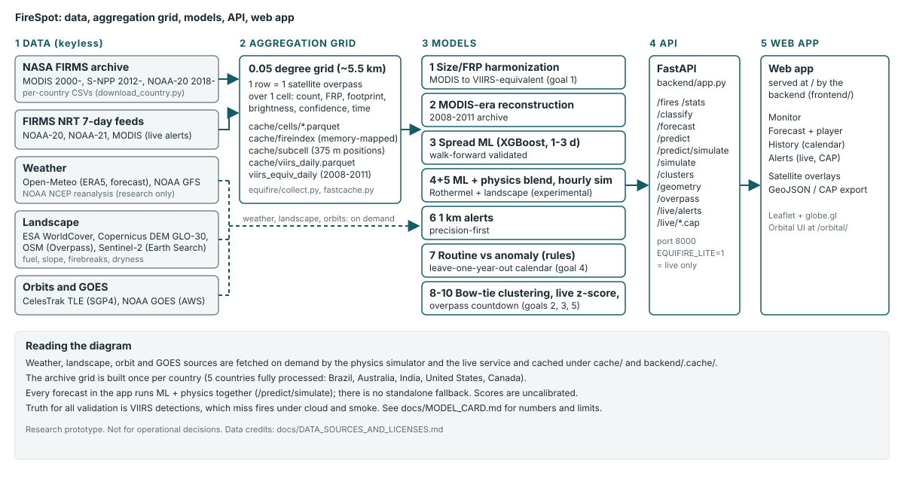

# FireSpot / EquiFire — szybki start (PL) · quick start (EN)

**Modele są już wytrenowane** (katalog `models/`), więc nie trzeba niczego trenować. Aplikacja działa od razu; dane pożarowe pobiera jeden skrypt.
**The models are pre-trained** (`models/` folder): no training needed. One script downloads the fire data.

```bash
# 1. środowisko / environment (Python 3.11+; tested on 3.14)
python -m venv .venv && source .venv/bin/activate        # Windows: .venv\Scripts\activate
pip install -r requirements.txt

# 2. dane NASA FIRMS (publiczne, bez klucza i konta) / public NASA FIRMS data, no key, no account
python download_data.py                    # Brazylia, Australia, Indie, USA, Kanada, 2000-2025, ok. 10 GB, potem buduje cache
python download_data.py --years 2018 2025  # mały test, ok. 1-2 GB / small test download
python download_data.py --all              # wszystkie 176 krajów, ok. 43 GB / all countries
python download_data.py --tle              # odśwież orbity satelitów / refresh satellite orbits

# 3. uruchom / run  (strona + API na jednym porcie / site + API on one port)
python -m uvicorn backend.app:app --host 0.0.0.0 --port 8080
# otwórz / open  http://localhost:8080   ·  dokumentacja API / API docs: http://localhost:8080/docs
```

**Bez pobierania danych działają:** zapisane powtórki 6 pożarów (zakładka Powtórka), strona, wykresy 25-letniego zapisu, dokumentacja.
**Needs the data:** the archive features (History, `/forecast`, `/predict`, `/classify`, `/stats`). Live fires and alerts use the public NASA near-real-time feeds (internet needed).

Co jest w repozytorium / what is here: kod (`backend/`, `equifire/`, `frontend/`, `scripts/`, `tests/`), wytrenowane modele (`models/`, ok. 170 MB; największy plik `spread_direct.json` ma 76 MB),
zapisane powtórki i demo (`cache/replay/`, `cache/demo/`), raporty z wynikami (`reports/`), dokumentacja (`docs/`: karta modelu, licencje, skrypt demo).
Wyniki i ograniczenia: `docs/MODEL_CARD.md`. Eksperymentalne, niekalibrowane — nie do decyzji operacyjnych. / Experimental and uncalibrated: not for operational decisions.

Trening od zera (opcjonalnie) / retrain from scratch (optional): `python main.py` · `python main.py direct --use-gpu` · `python forecast.py --walk-forward`.

---

# FireSpot

**Harmonization of MODIS and VIIRS hot spots, with early warning and short-range spread forecasts.**
NASA Space Apps Challenge 2026. Project FireSpot (credits: *placeholder, add team names*).

> Research prototype. Not validated for operational decisions (evacuation, dispatch, insurance pricing, safety of life). Forecast scores are uncalibrated. Read [docs/MODEL_CARD.md](docs/MODEL_CARD.md) before quoting any number.

## What it is

MODIS (1 km pixels, 2000-) and VIIRS (375 m, 2012-) split the same fire differently, which creates an artificial step in multi-decade fire statistics and confuses emergency monitoring. FireSpot is a deterministic harmonization engine plus a web app for responders, researchers, land managers and insurance analysts. It follows the eight goals in `HAKATON.pdf` (in Polish):

| # | Goal | What we built | Where |
|---|---|---|---|
| 1 | Space-time aggregation and cross-calibration of FRP | Common 0.05 degree grid; learned MODIS to VIIRS-equivalent size and FRP; 2008-2011 VIIRS-equivalent reconstruction | `equifire/collect.py`, `equifire/harmonize.py`, `harmonize.py` |
| 2 | Bow-tie / scan-geometry correction | SGP4 + TLE (or pixel-size) scan angle; cluster radius scaled by footprint | `equifire/geometry.py`, `equifire/clusters.py`, `/geometry`, `/clusters` |
| 3 | Real-time anomaly index (early warning) | FIRMS NRT feeds vs same-week 18-year baseline, z-score, watch/warning/critical | `backend/live.py`, `/live/*` |
| 4 | Routine agricultural burning vs anomaly | Calendar + seven evidence rules, plain-language reasons | `classify.py`, `equifire/seasonal.py`, `/classify` |
| 5 | Countdown to the next satellite pass | SGP4 passes for Terra, Aqua, S-NPP, NOAA-20, NOAA-21 | `backend/orbits.py`, `/overpass` |
| 6 | Dead zones / cloud masking | **Partial**: heuristic "burned yesterday, unseen today" gap cells (`/fires?gaps=true`). No real cloud-cover overlay yet | `backend/` |
| 7 | Slope- and wind-aware spread cone | Rothermel physics with hourly weather, WorldCover fuels, Copernicus slope, OSM firebreaks, plus an ML daily model | `backend/physics_spread.py`, `equifire/landscape.py`, `/simulate`, `/predict` |
| 8 | CAP / GeoJSON export | CAP 1.2 and GeoJSON for forecasts and live alerts | `backend/cap.py`, `/forecast.cap`, `/live/alerts.cap` |

## Architecture



Data (FIRMS archive and NRT, weather, landscape, orbits) is aggregated onto a 0.05 degree grid (about 5.5 km, one row per satellite overpass over one cell), memory-mapped for fast access, consumed by the models, served by a FastAPI backend, and shown in a single-page web app that the backend itself serves.

## Setup (one command block)

Developed and tested on Python 3.14 (older versions untested). Disk: on the dev machine `data_country/` is 38 GB, `cache/` 14 GB and `models/` 358 MB; the full 176-country archive is about 43 GB.

```sh
python -m venv .venv && .venv/bin/pip install -r requirements.txt
```

No account or API key is needed. An optional `.env` in the project root with `FIRMS_MAP_KEY=<your free FIRMS key>` enables only the `/firms/last24h` and `/firms/date` area routes; everything else (archive analysis, live alerts, forecasts) works without it. Never commit `.env`.

## Get the data

The archive CSVs come from NASA FIRMS country downloads (resumable, parallel):

```sh
# the five fully processed countries, 2012-2025, about 10 GB budget
.venv/bin/python download_country.py --countries Brazil Australia India United_States Canada --years 2012 2025 --budget-gb 10
# then aggregate into the cache (grid, fire index, daily tables)
.venv/bin/python main.py collect
```

The large directories (`data_country/`, `cache/`, `models/`) are generated or downloaded locally; keep them out of version control and zips. Heavy steps (`python main.py`, `walk_forward.py`, `harmonize.py`) take hours and 10 GB or more of RAM; the app only needs the finished caches and models.

## Run

```sh
# API and web app on one port (frontend/ is served by the backend at /)
.venv/bin/python -m uvicorn backend.app:app --host 0.0.0.0 --port 8080
# open http://127.0.0.1:8080/       interactive API docs: http://127.0.0.1:8080/docs
```

- Startup returns immediately; `GET /health` reports `loading` then `ready` (about 26 s with warm caches; the first start builds `backend/.cache/daily.parquet`, which takes minutes).
- **Light mode:** `EQUIFIRE_LITE=1 .venv/bin/python -m uvicorn backend.app:app --port 8080` serves live features only (live fires, alerts, overpasses, Orbital UI) and does not load the archive (about 0.7 GB peak in the test, versus several GB).
- The web app is a static build-free bundle. For frontend work you may also serve it separately: `.venv/bin/python -m http.server 5173 -d frontend` (the backend allows cross-origin requests, but the same-origin setup above is the one the team tests).
- Orbital Fire Watch satellite UI: `http://127.0.0.1:8080/orbital/` (rebuild with `cd orbital/frontend && npm install && npx vite build`).

### Pre-warm for a demo

```sh
.venv/bin/python scripts/demo_cache.py                 # Flin Flon, Manitoba, 2025-05-28
```

Then follow [docs/DEMO_SCRIPT.md](docs/DEMO_SCRIPT.md).

## Tests

```sh
.venv/bin/python -m unittest discover -s tests -q      # physics, ensemble, GFS, landscape, fire weather, GOES, alerts
.venv/bin/python -m pytest backend -q                  # API, stats, FIRMS, live alerts, geometry
```

The project reports record 98 passed / 2 skipped at the last full run (`reports/PREDICTION_LATENCY.md`); network tests are opt-in (for example `NET=1`, `EQUIFIRE_SLOW=1`). Tests use synthetic data unless stated.

## Repository layout

| Path | Contents |
|---|---|
| `backend/` | FastAPI app (`app.py`), live alerts, stats, physics simulator, combined ML + physics, CAP export, tests |
| `frontend/` | Single-page web app (Leaflet, globe.gl), no build step |
| `orbital/` | React "Orbital Fire Watch" satellite viewer (built into `orbital/frontend/dist`) |
| `equifire/` | Core library: collection, fire index, direct spread model, harmonization, seasonal calendar, geometry, clusters, landscape, weather providers |
| `main.py`, `walk_forward.py`, `forecast.py`, `harmonize.py`, `classify.py`, `bowtie.py`, `alerts1km.py` | Training, benchmarking and CLI entry points |
| `download_country.py`, `download_firms.py` | Data download |
| `scripts/` | `demo_cache.py` (demo pre-warm), `modis_era_pilot.py` |
| `tests/` | Unit tests and reference data |
| `reports/` | Measured results (JSON/CSV/MD) behind every number we quote |
| `docs/` | `MODEL_CARD.md`, `DATA_SOURCES_AND_LICENSES.md`, `DEMO_SCRIPT.md`, `architecture.svg` |
| `TODO.md`, `COORDINATION.md` | Status, method notes, results log |
| `cache/`, `data_country/`, `models/` | Large generated/downloaded data (keep out of git) |

## Status and limitations (honest)

- **Spread forecasts (ML), unseen fires, walk-forward, 100 fires per year:** within 5 km, day 1 is 52.5 / 59.3 / 52.1% and day 3 is 69.2 / 75.6 / 71.9% (2023 / 2024 / 2025); exact-cell day 3 is 24.7 / 30.7 / 27.3%. The target of 70% on day 1 is **not met**.
- **ML + physics blend:** no measurable gain over ML (day 1 tolerance 58.68 vs 58.89% in 2024; 56.82 vs 57.09% in 2025). It is the app's default forecast by design, labelled experimental.
- **Physics simulator:** checked on 20 fires only and over-predicts area (typically 3-6x with calibration); the newer landscape model has no accuracy validation.
- **1 km alerts:** precision 63.2% (next day) and 65.7% (3 days) with recall of only 9.2% and 15.1%.
- **Routine vs anomaly:** 10/12 on 12 independent events (21/22 on the tuning set, optimistic).
- **Bow-tie:** MODIS clusters per VIIRS fire at the swath edge 1.339 to 1.007, at the cost of merging nearby real fires.
- **MODIS to VIIRS reconstruction:** IoU 0.248 vs 0.177 for raw MODIS; total detections 1.00x vs 0.11x; spread skill on reconstructed years 0.114 vs 0.209 with real VIIRS.
- Truth is VIIRS detections, which miss fires under cloud and smoke. Baselines and training fully cover five countries only (Brazil, Australia, India, United States, Canada). Weather in backtests is observed reanalysis, not issued forecasts. Dead-zone masking is a heuristic. Suomi NPP no longer delivers new NRT data.
- Full details, caveats and a "claims we do not make" table: [docs/MODEL_CARD.md](docs/MODEL_CARD.md).

## Data and licences

All data are keyless open sources; credits and terms (including items we could not verify) are in [docs/DATA_SOURCES_AND_LICENSES.md](docs/DATA_SOURCES_AND_LICENSES.md). Attribution to show in the app: NASA FIRMS, Open-Meteo.com (CC BY 4.0), ESA WorldCover (CC BY 4.0), Copernicus DEM and Sentinel, OpenStreetMap contributors (ODbL), NOAA, RainViewer, Esri.

## Team and licence

- Team: *placeholder: add names and roles.*
- Code licence: *placeholder: to be chosen by the team (no LICENSE file exists yet).*
- Not endorsed by NASA, ESA, NOAA, Copernicus or any data provider.
