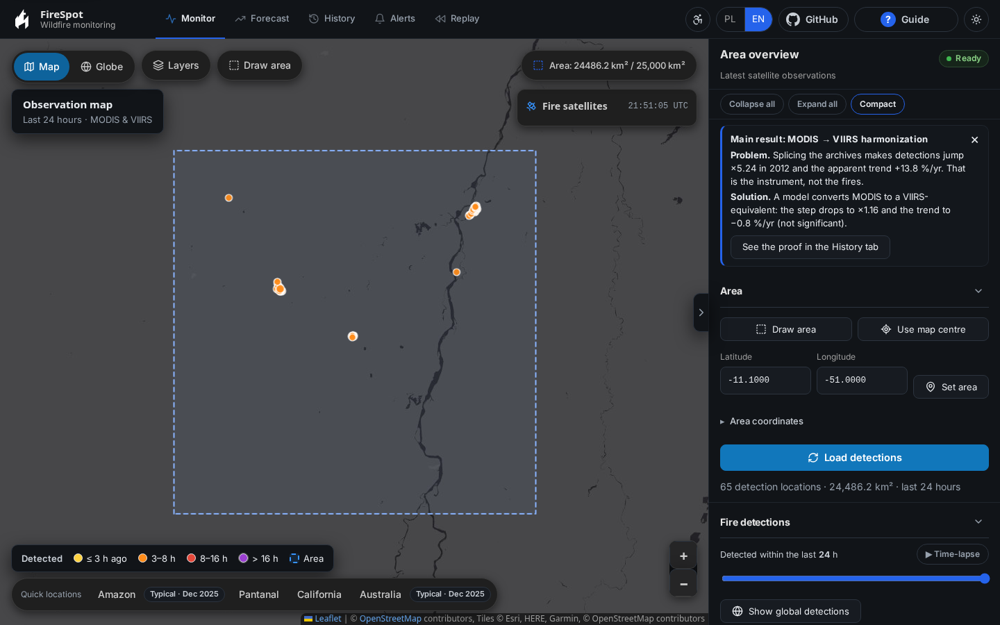
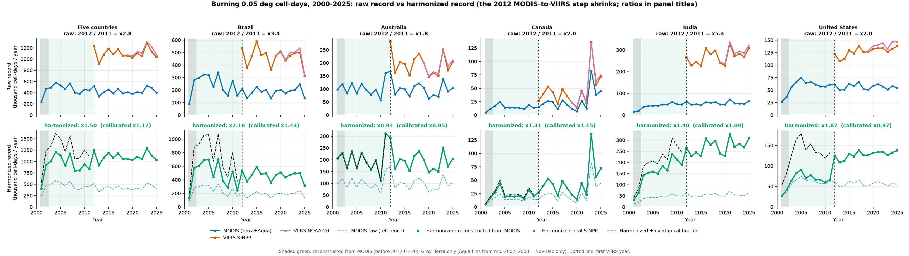
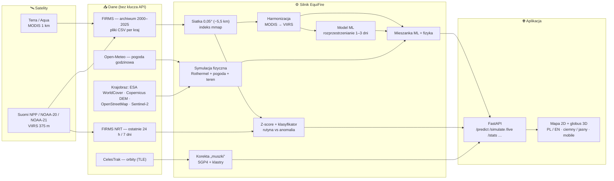
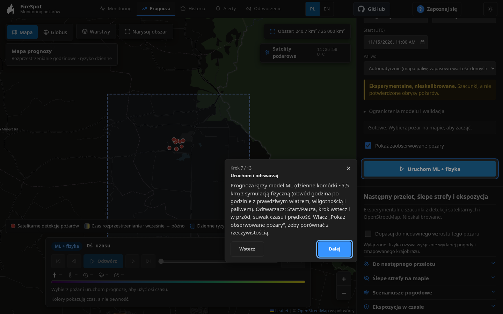
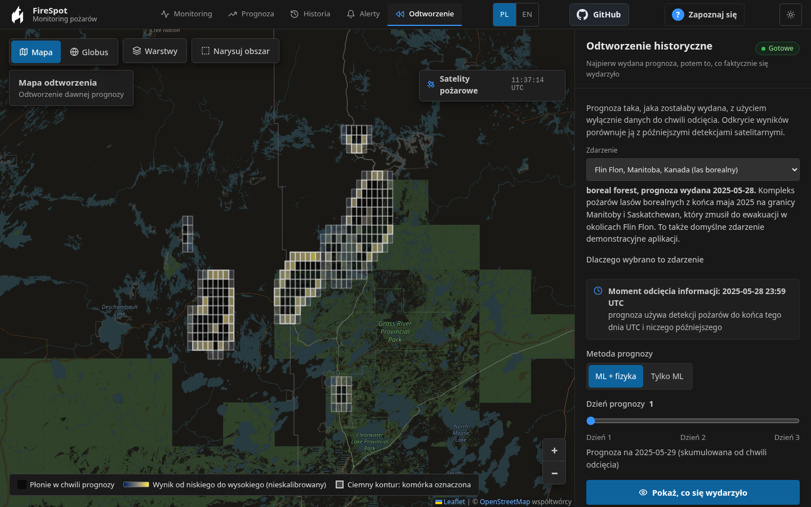
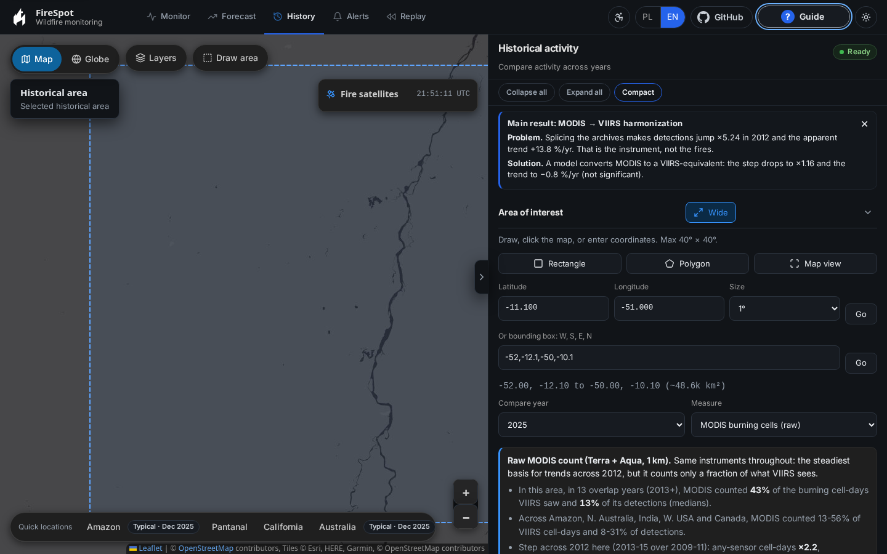
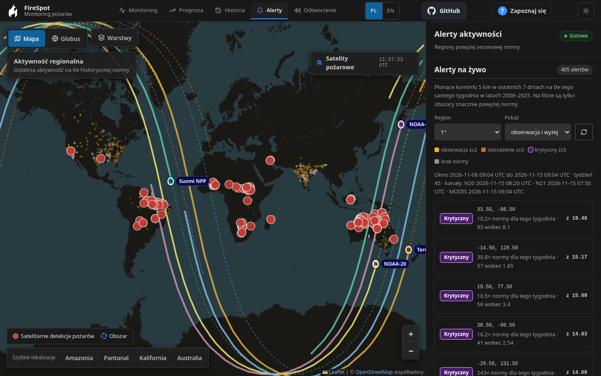
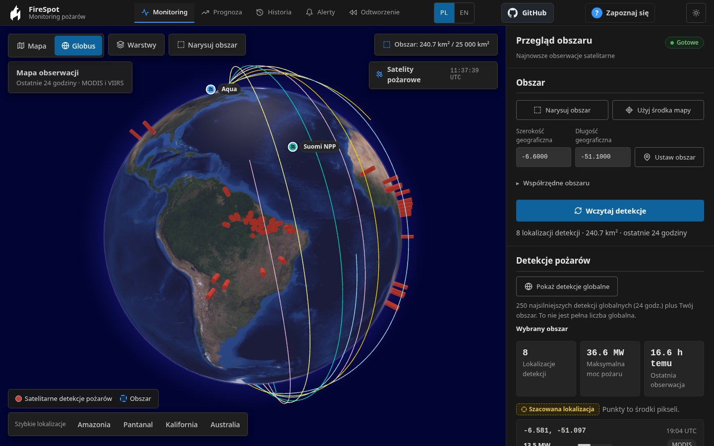
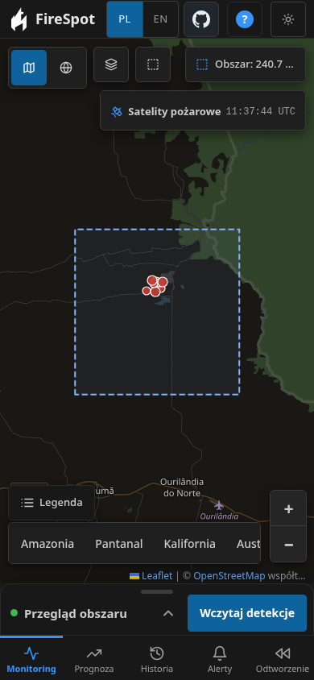
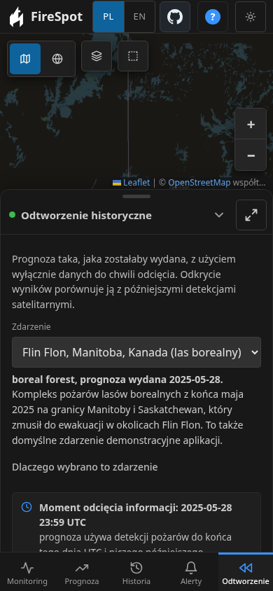

<div align="center">

# 🔥 FireSpot (EquiFire)

### Harmonizacja detekcji pożarów MODIS i VIIRS, wczesne ostrzeganie i krótkoterminowe prognozy rozprzestrzeniania

*NASA Space Apps Challenge 2026 — wyzwanie **Harmonization of MODIS and VIIRS Hot Spots***


**[🇬🇧 English version → README.md](README.md)**

<p align="center">
  <a href="docs/FireSpot_Master_Guide.pdf"><b>📘 Master Guide (PDF, 100 stron, po angielsku)</b></a> ·
  <a href="https://firespot.filipklon.online"><b>🌐 Wersja na żywo</b></a> ·
  <a href="docs/MODEL_CARD.md"><b>🧾 Karta modelu</b></a> ·
  <a href="docs/DEMO_SCRIPT.md"><b>🎬 Scenariusz pokazu</b></a>
</p>

| 🛰️ Harmonizacja | 🚨 Alerty na żywo | 🔮 Prognoza i weryfikacja |
|---|---|---|
| MODIS → ekwiwalent VIIRS, skok wykryć w 2012 r. ×5,24 → ×1,16 | porównanie z tym samym tygodniem 2008–2025, rutyna vs anomalia, eksport CAP | ML + fizyka na 1–3 dni, odtworzenia bez wycieku, uczciwe wyniki (także negatywne) |




</div>

> ⚠️ **Prototyp badawczy.** Wyniki są eksperymentalne i niekalibrowane. Narzędzie **nie** służy do decyzji operacyjnych (ewakuacja, dysponowanie sił, ubezpieczenia, bezpieczeństwo życia). Wszystkie liczby w tym pliku pochodzą z naszych raportów (`reports/`) i opisane są w [karcie modelu](docs/MODEL_CARD.md) razem z ograniczeniami.

---

## 📑 Spis treści

1. [Co to jest i po co](#-co-to-jest-i-po-co)
2. [Problem: skok w danych w 2012 roku](#-problem-skok-w-danych-w-2012-roku)
3. [Co zbudowaliśmy — 8 celów wyzwania](#-co-zbudowaliśmy--8-celów-wyzwania)
4. [Jak to działa (architektura)](#-jak-to-działa-architektura)
5. [Aplikacja webowa — przegląd](#-aplikacja-webowa--przegląd)
6. [Moduły dodatkowe (zakładka Prognoza)](#-moduły-dodatkowe-zakładka-prognoza)
7. [Metody krok po kroku](#-metody-krok-po-kroku)
8. [Wyniki — uczciwie](#-wyniki--uczciwie)
9. [Eksperymenty z wynikiem negatywnym lub słabym](#-eksperymenty-z-wynikiem-negatywnym-lub-słabym)
10. [Szybki start](#-szybki-start)
11. [Dane i licencje](#-dane-i-licencje)
12. [API](#-api)
13. [Struktura repozytorium](#-struktura-repozytorium)
14. [Testy i demo](#-testy-i-demo)
15. [Ograniczenia](#-ograniczenia)
16. [Zespół, licencja, podziękowania](#-zespół-licencja-podziękowania)

---

## 🎯 Co to jest i po co

**FireSpot** to narzędzie dla służb ratowniczych, naukowców, zarządców terenu i strażaków. Łączy w jednym miejscu:

- **harmonizację danych satelitarnych** — doprowadza stare pomiary MODIS (1 km, od 2000 r.) i nowsze VIIRS (375 m, od 2012 r.) do jednego, porównywalnego zapisu 2000–2025,
- **monitoring na żywo** — pożary z ostatnich 24 godzin na mapie 2D i globusie 3D, razem z orbitami satelitów,
- **wczesne ostrzeganie** — porównanie bieżącej aktywności z tym samym tygodniem w latach 2008–2025 (z-score) i rozróżnienie *rutynowego wypalania* od *anomalii*,
- **prognozy rozprzestrzeniania** — model uczenia maszynowego (komórki ~5,5 km, 1–3 dni) połączony z symulacją fizyczną (obwód godzina po godzinie z wiatrem, wilgotnością, paliwem, terenem i barierami),
- **uczciwą weryfikację** — „Odtworzenie”: prognoza wydana tylko z danych dostępnych w chwili startu, a dopiero potem porównanie z tym, co satelity faktycznie zobaczyły.

Silnik analityczny nazywa się **EquiFire** (katalog `equifire/`), aplikacja — **FireSpot** (`backend/` + `frontend/`).

---

## 🛰️ Problem: skok w danych w 2012 roku

MODIS (satelity Terra od 2000 r. i Aqua od 2002 r.) ma piksel ≈ **1 km²**. VIIRS (Suomi NPP od 2012 r., NOAA-20 od 2018 r., NOAA-21 od 2023 r.) ma piksel ≈ **0,14 km²** (375 m). Ten sam pożar wygląda zupełnie inaczej:

| | MODIS | VIIRS |
|---|---|---|
| Piksel w nadirze | 1 km | 375 m |
| Mały pożar | często niewidoczny | często widoczny |
| Jeden duży front | 1 punkt | wiele punktów |
| Moc promieniowania (FRP) | uśredniana z tłem | inna skala |
| Krawędź pasa skanowania | piksel do 2,0 × 4,8 km (efekt „muszki”) | podobne zniekształcenie |

Skutek: po sklejeniu zapisów liczba wykryć **skacze w 2012 roku ×5,2**, a „trend” pożarów rośnie o **+13,8% rocznie** (liczba wykryć, 5 krajów) — głównie przez zmianę instrumentu, nie przez zmianę pożarów. Nasza harmonizacja sprowadza skok do **×1,16**, a trend do **−0,8%/rok (nieistotny statystycznie)**.



---

## ✅ Co zbudowaliśmy — 8 celów wyzwania

| # | Cel | Co zrobiliśmy | Gdzie w kodzie |
|---|---|---|---|
| 1 | Agregacja czasoprzestrzenna i kalibracja krzyżowa FRP | wspólna siatka 0,05°; model MODIS → ekwiwalent VIIRS (powierzchnia i FRP); rekonstrukcja VIIRS-owa dla lat 2000–2011 | `equifire/collect.py`, `equifire/harmonize.py`, `harmonize.py` |
| 2 | Korekta efektu „muszki” | kąt skanowania z SGP4 + TLE (albo z rozmiaru piksela), promień grupowania zależny od odcisku piksela | `equifire/geometry.py`, `equifire/clusters.py`, `/geometry`, `/clusters` |
| 3 | Wskaźnik anomalii w czasie rzeczywistym | strumienie FIRMS NRT vs. 18-letnie tło tego samego tygodnia; poziomy: obserwuj / ostrzeżenie / krytyczny | `backend/live.py`, `/live/*` |
| 4 | Rutynowe wypalanie rolnicze vs anomalia | kalendarz regionu + siedem reguł dowodowych + uzasadnienie słowne | `classify.py`, `equifire/seasonal.py`, `/classify` |
| 5 | Odliczanie do następnego przelotu satelity | SGP4 dla Terra, Aqua, Suomi NPP, NOAA-20, NOAA-21 | `backend/orbits.py`, `/overpass`, `/nextobs` |
| 6 | Martwe strefy i maskowanie chmur | **częściowo:** rozróżnienie „brak pożaru” od „zbyt słaba obserwacja” z widocznością chmur (wskaźnik, nie dowód) | `backend/nextobs.py`, `/blindspots` |
| 7 | Stożek rozprzestrzeniania z wiatrem i terenem | fizyka Rothermela z godzinową pogodą, paliwem z ESA WorldCover, nachyleniem z Copernicus DEM i barierami z OpenStreetMap + model ML | `backend/physics_spread.py`, `equifire/landscape.py`, `/simulate`, `/predict` |
| 8 | Eksport CAP / GeoJSON | CAP 1.2 i GeoJSON dla prognoz i alertów na żywo | `backend/cap.py`, `/forecast.cap`, `/live/alerts.cap` |

**Dodatki ponad wymagania:** historyczne odtworzenie z odkryciem wyniku, scenariusze pogodowe, szacowana ekspozycja obiektów, karta zdarzenia do wydruku, przewodnik krok po kroku w aplikacji, interfejs po polsku i angielsku, motyw ciemny/jasny, układ mobilny.

---

## 🧩 Jak to działa (architektura)



**Przepływ w skrócie**

1. **Pobranie** — publiczne pliki CSV FIRMS (po kraju i roku) oraz strumienie NRT. Żaden klucz ani konto nie są potrzebne.
2. **Agregacja** — każde wykrycie trafia do komórki siatki 0,05° (~5,5 km). Jeden wiersz = jeden przelot satelity nad jedną komórką (liczba wykryć, FRP, odcisk piksela, jasność, pewność, czas). Zbiór (ponad 100 mln komórko-dni) jest indeksowany w plikach mapowanych w pamięci (`np.memmap`), więc działa na zwykłym laptopie.
3. **Harmonizacja** — modele uczą się na parach jednoczesnych obserwacji MODIS i VIIRS (±30 min, ta sama komórka) i przeliczają MODIS na ekwiwalent VIIRS.
4. **Modele** — spread ML, symulacja fizyczna i ich mieszanka, alerty 1 km, klasyfikator rutyna/anomalia.
5. **Obsługa** — FastAPI serwuje API i statyczny frontend na jednym porcie.

---

## 🖥️ Aplikacja webowa — przegląd

Aplikacja nie wymaga budowania (czysty HTML/CSS/JS: Leaflet + globe.gl). Domyślnie po angielsku, przełącznik **EN | PL**, ciemny motyw w stylu VS Code (jasny dostępny), pełny układ mobilny z dolnym panelem.

| Monitoring | Przewodnik „? Zapoznaj się” |
|---|---|
|  |  |
| Obszar do 25 000 km², detekcje z 24 h, wiek obserwacji, orbity satelitów, radar opadów i wiatr | 30-krokowa wycieczka po wszystkich ekranach i funkcjach z podświetleniem elementów |

| Odtworzenie (uczciwa weryfikacja) | Historia i zapis 25-letni |
|---|---|
|  |  |
| najpierw prognoza z danych do chwili startu, potem „Pokaż, co się wydarzyło” | kalendarz pożarów, porównanie z innymi latami, zapis zharmonizowany |

| Alerty | Globus 3D |
|---|---|
|  |  |
| regiony ponad normą z tego samego tygodnia, eksport CAP 1.2 / GeoJSON | pięć satelitów z orbitami i punkty pożarów |

| Mobile — Monitoring | Mobile — Odtworzenie |
|---|---|
|  |  |

**Zakładki:** *Monitoring* (bieżące detekcje) · *Prognoza* (ML + fizyka, odtwarzacz godzinowy, dodatki) · *Historia* (porównania wieloletnie, kalendarz, zapis 25-letni) · *Alerty* (anomalie na żywo) · *Odtworzenie* (weryfikacja prognoz).

**Dodatki w zakładce Prognoza:** do następnego przelotu (kiedy satelita znów zobaczy pożar i czy chmury go zasłonią), martwe strefy, scenariusze pogodowe („co jeśli wiatr będzie silniejszy / spadnie deszcz” — oznaczone jako hipotetyczne), szacowana ekspozycja obiektów (osady, drogi, linie energetyczne, szpitale, szkoły — **bez wartości pieniężnych**) i karta zdarzenia do wydruku.

---

## 🧰 Moduły dodatkowe (zakładka Prognoza)

| Moduł | Co robi | Czego **nie** robi |
|---|---|---|
| 🛸 **Trasa drona rozpoznawczego** (`backend/drone.py`) | z gotowej prognozy buduje trasę wokół przewidywanego obrysu pożaru (domyślnie za 2 h): większy odstęp po stronie zawietrznej, start od nawietrznej, zawis z kamerą na punktach zapłonu, limit czasu lotu. Eksport GPX, KML, CSV (Litchi), GeoJSON. | nie modeluje prądów wstępujących ani turbulencji, nie zna przestrzeni powietrznej; **to pomoc w planowaniu, nie plan lotu**. Brak natywnego pliku DJI. |
| 💶 **Licznik CO₂ i wartości** (`backend/carbon.py`) | FRP → biomasa (Wooster 2005: 0,368 kg/MJ) → CO₂ (współczynniki wg biomu) → wartość po **założonej** cenie (domyślnie 70 €/t). Tryb „na żywo” (FIRMS, ostatnie 24 h) i „dla prognozy” (podąża za suwakiem). | cena nie jest pobierana na żywo (brak darmowego źródła bez klucza); to **nie** szkoda ani wartość ubezpieczeniowa; dokładność rzędu współczynnika 2–3. |
| 📡 **Direct Broadcast** (`backend/dbnet.py`) | z orbit (SGP4) liczy, czy stacja odbiorcza (Fairbanks, Svalbard, White Sands, McMurdo, Greenbelt) ma satelitę nad horyzontem w chwili obserwacji pożaru, kiedy satelita następnie spotka stację, odliczanie do następnej obserwacji; stacje i łącza na globusie 3D. | nie mamy odbiornika X-band i nie przetwarzamy L0/L1/L2; **nie twierdzimy**, że alert jest szybszy niż w FIRMS (podajemy tylko opublikowane „ok. 3 h”). Lista stacji jest przybliżona. |
| ☀️ **Geometria Słońce–satelita** (`backend/dbnet.py`, `/illumination`) | kąty Słońca i satelity w chwili przelotu: zenit, azymut względny, kąt rozpraszania, kąt odblasku (sun glint) i ryzyko fałszywych alarmów. | **nie stosujemy** korekty BRDF (MCD43) ani stałej poprawki procentowej; detekcja pożarów opiera się na pasmach termicznych. |
| 🎲 **Monte Carlo** (`backend/monte_carlo.py`) | zespół przebiegów fizyki z zaburzonym wiatrem, wilgotnością i tempem; izolinie **częstości w zespole** (20/50/80/95 %) | częstość w zespole to **nie** szansa realnego pożaru: brak niezależnej kalibracji; zakresy zaburzeń są założone, nie z operacyjnego zespołu pogodowego |
| 🛰️ **Nowcasting następnej obserwacji** (`backend/nowcast.py`, #8) | ekstrapoluje czoło ognia do okna przelotu z `nextobs` i szacuje, co satelita zobaczy | nie jest prognozą trafności; opiera się na prognozie fizycznej i modelowanym zachmurzeniu |
| 🧯 **Firebreak sandbox** (`backend/firebreak.py`) | „co jeśli” dla pasa przeciwpożarowego, zrzutu lub wypalania; **heurystyczny wskaźnik utrzymania linii** | wskaźnik **nie** jest prawdopodobieństwem: nieskalibrowany i niezwalidowany na akcjach gaśniczych; nie plan operacyjny |
| 🚨 **Ranking priorytetów** (`backend/fire_priority.py`, #20) | lista pożarów wg wag (ekspozycja, tempo, FRP, suchość paliwa), poziomy P1–P4 | wagi są założone; to pomoc w triage, nie decyzja |
| 🌿 **Analiza błędów wg biomu** (`backend/biome_errors.py`, #27) | tabela błędów odtworzeń (FP/FN/IoU) wg biomu | 6 zdarzeń; bez nauki na teście; liczby zależą od dostępnych zapisanych replayów |
| 📄 **PDF dla każdego widoku** (`backend/analysis_reports.py`, `POST /reports/pdf`) | raport istniejącego wyniku z widoku, bez nowej symulacji | nie liczy niczego od nowa |
| 🔗 **Tymczasowy link do analizy** (`backend/shared_analysis.py`, #24) | krótki kod z ograniczonym czasem życia, po wygaśnięciu „link wygasł” | nie przechowuje danych w adresie |
| 📲 **Telegram** (`backend/telegram_alerts.py`, #23) | powiadomienia; token i czat z `.env` | nic nie wysyła bez zgłoszonego obszaru i kliknięcia; bez tokenu pokazuje instrukcję; sekretów nie loguje |
| 💬 **Wyjaśnienia „dlaczego tak”** (`frontend/ui-explanations.js`, #22) | regułowe podsumowanie wejść, modelu i selekcji komórek, deterministyczne | bez atrybucji przyczynowej; nie zmienia wyniku |
| ➕ **Extra data** (`frontend/ui-extra-data.js`) | zwijana sekcja danych pomocniczych: **#9** mapa niezgodności rekonstrukcji z MODIS vs prawdziwy VIIRS (kafelki 1°, 2022–2025, 5 krajów); **#10** niezależna spalona powierzchnia EFFIS; **#13** maska stałych źródeł ciepła; **#15** wskaźnik jakości obserwacji | **#10 tylko Europa i Morze Śródziemne**, poza nią „brak danych”; wskaźnik jakości to nie przedział ufności; dane pomocnicze nie wchodzą do wyników prognozy |
| ⏱️ **Opóźnienie wykrycia w naszym pollerze** (`backend/latency.py`, #17) | czas od obserwacji do pierwszego zobaczenia detekcji w publicznym strumieniu FIRMS, odpytywanie co 5 min | to **nie** wewnętrzny czas FIRMS ani opóźnienie Direct Broadcast; rozdzielczość 5 min; detekcje obecne przy pierwszym odpytaniu pominięte |
| 📏 **Flaga zakresu modelu** (`equifire/scope_flag.py`, `/scope/check`, #33) | czy przypadek mieści się w zakresie przypadków treningowych (rozmiar, historia 30/365 dni, ilość danych w kafelku 5°) | to flaga zakresu, **nie** pewność; brak dowodu, że przewiduje błąd (patrz niżej) |
| 🎚️ **Suwak przed / po harmonizacji** (`frontend/ui-harmonize-compare.js`, #11) | w Historii kurtyna: surowe sklejenie vs zapis zharmonizowany, skok 2011→2012 ×5,24 → ×1,16 | to wykres istniejących danych, bez nowych obliczeń |
| 📐 **Diagnostyka kalibracji** (`backend/risk_diagnostics.py`, `/risk/diagnostics`, #1) | wykres rzetelności i ECE/Brier dziennego ryzyka | kandydat badawczy: poprawa trafności **nie wykazana** (przedziały różnicy Brier obejmują zero) |
| 🌫️ **Ocena w masce obserwacji** (zakładka Odtworzenie, #2) | po „Reveal what happened” pełna i maskowana ocena obok siebie | maska = modelowane zachmurzenie ERA5, nie maska pikseli satelity; przy pełnej obserwowalności obie miary są równe |

## 🔬 Metody krok po kroku

### 1. Siatka i agregacja (`equifire/collect.py`)
Wspólna siatka równokątna 0,05° (`gx = ⌊(lon+180)/0,05⌋`, `gy = ⌊(lat+90)/0,05⌋`). Każde wykrycie typu 0 (przypuszczalny pożar roślinności) trafia do komórki. Wiersze agregują się po `(dzień, komórka, satelita, dzień/noc)`. Pliki Parquet i indeksy `.npy` są mapowane w pamięci, więc kilka programów dzieli jedną kopię danych.

### 2. Harmonizacja MODIS → VIIRS (`equifire/harmonize.py`, `equifire/datasets.py`)
- **Pary uczące:** jednoczesne obserwacje MODIS i VIIRS (±30 min, ta sama komórka); VIIRS jest „prawdą”. Liczba par nie jest zapisana w raportach, więc jej nie podajemy.
- **Modele wielkości i FRP:** regresja gradientowa; cechy to m.in. liczba pikseli, suma i maksimum FRP, kąty skanu, jasność, pewność, sąsiedztwo, pora roku.
- **Rekonstrukcja archiwum 2000–2011:** klasyfikator „czy VIIRS zobaczyłby ogień w tej komórce” (kandydaci: komórki w odległości ≤ 2 od pożaru MODIS) + regresje liczby wykryć, FRP i powierzchni. Uczone na 2012–2019, dobór progu na 2020, test na 2021–2025.
- **Zapis 25-letni:** surowy MODIS, surowy VIIRS (S-NPP i NOAA-20 osobno) i zapis zharmonizowany (dla lat 2012+ tylko S-NPP, by drugi satelita nie dodawał sztucznego skoku w 2018 r.).

### 3. Korekta efektu „muszki” (`equifire/geometry.py`, `equifire/clusters.py`)
Piksel rośnie od 1 km w nadirze do ok. 2,0 × 4,8 km na krawędzi pasa. Kąt skanowania liczymy z propagatora **SGP4** (dla świeżych danych) albo z rozmiaru piksela zapisanego w FIRMS (dla archiwum, bo dzisiejsze TLE nie opisują starych dat). Dwa wykrycia z jednego przelotu należą do tego samego pożaru, jeśli mieszczą się w elipsie o osiach zależnych od odcisku piksela (współczynnik sąsiedztwa 1,5). Algorytm: `cKDTree` + składowe spójne.

### 4. Model ML rozprzestrzeniania (`equifire/direct.py`)
**Bezpośredni model wielohoryzontowy:** zamiast symulować dzień po dniu (błędy się kumulują), jeden model odpowiada wprost: *„czy komórka zapali się w ciągu *k* dni?”*, używając wyłącznie informacji z dnia startu. Okno 41 × 41 komórek (~225 km), kilkadziesiąt cech: odległość od frontu, historia spalania (do 365 dni), pozycje wykryć wewnątrz komórki, kształt i tempo wzrostu pożaru, kierunek wiatru względem frontu, wilgotność, temperatura, opady. Wybór komórek dla każdego horyzontu optymalizowany pod nakładanie (IoU). Trening bez wycieku danych: model dla roku *Y* uczy się wyłącznie na latach wcześniejszych.

### 5. Symulacja fizyczna (`backend/physics_spread.py`, `equifire/landscape.py`)
Tempo rozprzestrzeniania wg **Rothermela (1972)** z poprawkami Albiniego, modele paliw Andersona, wilgotność paliw wg Simarda, wiatr na wysokości płomienia, nachylenie, eliptyczny kształt frontu (Anderson 1983), pożar koronowy dla lasów (Van Wagner). Wzrost frontu liczony metodą minimalnego czasu dojścia na siatce 250 m. Dane wejściowe (wszystkie bez klucza): godzinowa pogoda z Open-Meteo na siatce 5 × 5 punktów, paliwo z ESA WorldCover, teren z Copernicus DEM, bariery (drogi, rzeki, jeziora, zabudowa) z OpenStreetMap, wilgotność roślinności z Sentinel-2, wskaźnik FWI. Opcjonalna kalibracja tempa do niedawnego wzrostu danego pożaru.

### 6. Mieszanka ML + fizyka (`backend/ensemble.py`)
Mały model „blender” dostaje prawdopodobieństwo z ML i cechy z fizyki dla każdej komórki i dnia. **Uwaga:** w testach mieszanka nie dała mierzalnej poprawy względem samego ML (patrz wyniki). Zostawiamy ją, bo ją narzuca zadanie (prognoza musi używać obu składników), ale **nie twierdzimy, że poprawia trafność**.

### 7. Alerty i rutyna vs anomalia (`backend/live.py`, `equifire/seasonal.py`)
Aktywność z ostatnich 7 dni (NOAA-20) porównujemy ze średnią tego samego tygodnia w latach 2008–2025 dla regionu 1° lub 0,25°: `z = (obs − średnia) / max(odch., 0,3·średnia, √średnia+1)`. Poziomy: obserwuj `z ≥ 2`, ostrzeżenie `z ≥ 3`, krytyczny `z ≥ 5`, z flagą „poza sezonem”. Klasyfikator rutyna/anomalia łączy: częstość sezonową, z-score, powtarzalność tych samych pól co rok, skok jednodniowy, moc na detekcję, rozmiar i trwałość pożaru.

### 8. Odtworzenie bez wycieku (`backend/replay.py`)
Prognoza dostaje kopię indeksu pożarów **z usuniętą całą przyszłością**; testy sprawdzają, że wynik jest identyczny niezależnie od tego, czy przyszłość istnieje. Dopiero potem liczone jest porównanie: trafienia, chybienia, fałszywe alarmy — ściśle (ta sama komórka) i z tolerancją 5 km. Komórki, których satelita nie mógł zobaczyć (chmury, brak przelotu), są oznaczone osobno.

---

## 📊 Wyniki — uczciwie

Wszystkie liczby: **nieznane wcześniej pożary**, test „walk-forward” (model dla roku *Y* trenowany tylko na latach < *Y*), 100 pożarów rocznie. Źródła: `reports/`, szczegóły i ograniczenia w [`docs/MODEL_CARD.md`](docs/MODEL_CARD.md).

### Harmonizacja (zadanie główne)

| Miara | Surowy zapis (sklejony) | Zharmonizowany |
|---|---|---|
| Skok liczby wykryć 2012 / 2011 (5 krajów) | ×5,24 | **×1,16** |
| Pozorny trend liczby wykryć 2003–2025 | +13,8 %/rok | **−0,8 %/rok (nieistotny)** |
| Sumy wykryć vs prawdziwy VIIRS (lata testowe 2021–2025) | MODIS widzi 0,11× | **1,00× (korelacja roczna 0,99)** |
| Błąd wielkości pożaru po przeliczeniu MODIS → VIIRS | surowy MODIS | **−69 %** (−24 % vs prosta korekta liniowa) |
| Błąd FRP | surowy MODIS | **−18 %** |
| Nakładanie komórek (IoU) | 0,177 | **0,248** |

> Uwaga: skok liczby *komórko-dni* nadal wynosi ×1,5 (×1,12 po kalibracji do lat nakładania). Odtworzenie znajduje ok. 36 % komórek, które widziałby VIIRS, więc sumy komórek są obciążone regionalnie (0,5–1,5×). Najczystsze miary to **liczba wykryć** i **FRP**. Pełny zapis 2000–2025 mamy dla 5 krajów.

### Prognoza rozprzestrzeniania (ML)

| Test (100 pożarów / rok) | Dzień 1, w granicach 5 km | Dzień 3, w granicach 5 km | Dzień 3, dokładna komórka |
|---|---|---|---|
| 2024 — tylko ML | 58,9 % | 75,9 % | 30,8 % |
| 2025 — tylko ML | 57,1 % | 73,4 % | 28,5 % |
| 2024 — ML + fizyka | 58,7 % | 76,1 % | 30,7 % |
| 2025 — ML + fizyka | 56,8 % | 73,5 % | 28,3 % |
| fizyka sama (starsza wersja, bez krajobrazu) | ~22 % | 34–38 % | 10–12 % |

- **Cel 70 % dla dnia 1 nie został osiągnięty** (jest ok. 57–59 %).
- **Mieszanka ML + fizyka nie poprawia wyniku** (różnice ±0,3 pkt mieszczą się w szumie).
- Dzień 1 jest trudniejszy, bo cele są małe (często 1–5 komórek), a tylko ok. 29 % płonących komórek jest ponownie wykrywanych następnego dnia (chmury, dym, czas przelotu).

### Pozostałe moduły

| Moduł | Wynik |
|---|---|
| Symulacja fizyczna (20 pożarów) | bez warstw krajobrazu zawyża powierzchnię (typowo 3–6×, w najgorszym teście do ~19×); warstwy krajobrazu (paliwo, nachylenie, bariery) zbliżają medianę do ≈ 0,5–1,8×, ale **ta wersja nie ma pełnej walidacji**; **tylko narzędzie scenariuszowe** |
| Alerty 1 km (test 2023–2025) | precyzja 63 % (dzień 1) i 66 % (3 dni); czułość tylko 9 % i 15 % |
| Rutyna vs anomalia | 10/12 na niezależnych zdarzeniach (21/22 na zbiorze strojenia — optymistyczne) |
| Efekt „muszki” (brzeg pasa) | klastrów MODIS na jeden pożar VIIRS: 1,339 → **1,007** (kosztem scalania sąsiednich pożarów) |
| Odtworzenie, 6 zdarzeń | dzień 3 w granicach 5 km: 0,71–0,93; dzień 1 powyżej 0,70 tylko w 2 z 6 |
| Uczenie z własnych prognoz | zmiana trafności ok. +0,1 pkt — bez znaczenia |

---

## 🧪 Eksperymenty z wynikiem negatywnym lub słabym

Wszystkie wyniki są w `reports/`; nie wpinaliśmy ich do aplikacji jako działających funkcji.

| Pomysł | Wynik | Raport |
|---|---|---|
| Geostacjonarne GOES jako dodatkowe obserwacje (15 pożarów 2024, Ameryki) | sam ślad VIIRS z dnia 0 pokrywa 55,3 % nowych komórek dnia 1; GOES dokłada tylko **+2,5 pkt**; z 19 komórek tylko-GOES 7 (37 %) potwierdził VIIRS | `reports/goes_feasibility.json` |
| Model „eksplozywnego wzrostu” (test 2024, 1000 przypadków) | stopa bazowa 6,1 %; AUC modelu **0,68** (sam rozmiar pożaru 0,44); precyzja **17 %** przy czułości **15 %** | `reports/explosive_growth.json` |
| Frakcja ognia z kanałów MIR/TIR VIIRS (Australia 2024) | łączna powierzchnia ognia zależy od założonej temperatury ognia **×26** (4,4 do 113 km² dla 1200–600 K): powierzchni bezwzględnej nie da się odzyskać z pól FIRMS | `reports/subpixel_fire_fraction.json` |
| Flaga zakresu modelu (60 przypadków 2024) | 77 % oznaczonych „poza zakresem”; dzień 1 w 5 km 0,536 vs 0,580 w zakresie, dzień 3 odwrotnie (0,761 vs 0,630): **brak dowodu**, że flaga przewiduje błąd | `reports/scope_flag.json` |
| Kalibracja prawdopodobieństw dziennego ryzyka | ECE spada, ale wszystkie przedziały różnicy Brier obejmują zero: poprawa trafności nie wykazana | `reports/DAILY_RISK_CALIBRATION.md` |
| Mieszanka ML + fizyka | brak mierzalnego zysku względem samego ML (patrz wyniki powyżej) | `reports/ensemble_ab_*.json` |

### Czas pełnego wyniku ML + fizyka

Pomiar na jednej maszynie, małą próbą (`reports/ml_physics_timing.json`): pierwsze wywołanie **p50 5,5 s** dla zapisanych zdarzeń i **p50 13,7 s** (maks. 22,7 s) dla świeżych obszarów z 5 przetworzonych krajów; drugie wywołanie przy ciepłych dyskach p50 2,5–3,0 s. Prawdziwy zimny start zupełnie nowego miejsca (pobranie krajobrazu i pogody) nie został zmierzony i może trwać 2–3 min. Dla Kalimantanu (tylko ML) wynik zwraca 503: brak blendera ML + fizyka wytrenowanego przed 2023.

---

## 🚀 Szybki start

**Modele są już wytrenowane** (`models/`), więc niczego nie trzeba trenować.

```bash
# 1. środowisko (Python 3.11+; testowane na 3.14)
python -m venv .venv
source .venv/bin/activate            # Windows: .venv\Scripts\activate
pip install -r requirements.txt

# 2. dane NASA FIRMS (publiczne; bez klucza i konta)
python download_data.py                      # Brazylia, Australia, Indie, USA, Kanada · 2000–2025 · ok. 10 GB
python download_data.py --years 2018 2025    # mały test (ok. 1–2 GB)
python download_data.py --countries Poland Germany --years 2020 2025
python download_data.py --all                # wszystkie kraje z listy (238, ok. 43 GB)
python download_data.py --tle                # odśwież orbity satelitów

# 3. uruchom (strona i API na jednym porcie)
python -m uvicorn backend.app:app --host 0.0.0.0 --port 8080
# otwórz http://localhost:8080        dokumentacja API: http://localhost:8080/docs
```

**Bez pobierania danych działa:** zakładka *Odtworzenie* (6 zapisanych zdarzeń), strona, dokumentacja, wykresy zapisu 25-letniego. **Wymaga danych:** archiwalne funkcje (Historia, `/forecast`, `/predict`, `/classify`, `/stats`). **Funkcje „na żywo”** (detekcje, alerty) potrzebują internetu.

**Tryb lekki** (bez archiwum, ok. 0,7 GB RAM): `EQUIFIRE_LITE=1 python -m uvicorn backend.app:app --port 8080`.

Pierwsze uruchomienie z danymi buduje pamięć podręczną (kilka minut). Pobieranie jest wznawialne: uruchom ponownie, by kontynuować.

<details>
<summary><b>Trening od zera (opcjonalnie, godziny i ≥ 10 GB RAM)</b></summary>

```bash
python main.py                                 # zbiór → modele wielkości i rozprzestrzeniania
python main.py direct --use-gpu --direct-cases 5000   # model bezpośredni (GPU NVIDIA, XGBoost CUDA)
python forecast.py --walk-forward --runs 100 --days 3 # test walk-forward
python harmonize.py train && python harmonize.py eval  # rekonstrukcja MODIS → VIIRS
```
</details>

---

## 📚 Dane i licencje

Wszystkie źródła są **darmowe i bez klucza/konta**. Pełna lista z licencjami i tekstami atrybucji: [`docs/DATA_SOURCES_AND_LICENSES.md`](docs/DATA_SOURCES_AND_LICENSES.md).

| Dane | Źródło |
|---|---|
| Detekcje pożarów (archiwum i NRT) | NASA FIRMS — MODIS, VIIRS S-NPP / NOAA-20 / NOAA-21 |
| Pogoda | Open-Meteo (ERA5 i prognozy) — CC BY 4.0 |
| Pokrycie terenu / paliwo | ESA WorldCover 2021 — CC BY 4.0 |
| Teren | Copernicus DEM GLO-30 |
| Bariery i obiekty | OpenStreetMap (ODbL) przez Overpass API |
| Wilgotność roślinności | Sentinel-2 L2A (Earth Search) |
| Orbity | CelesTrak (TLE) |
| Szybkie zdjęcia geostacjonarne (Ameryki) | NOAA GOES (AWS) |
| Radar opadów | RainViewer |
| Ludność (szacunek) | Meta/CIESIN HRSL |

---

## 🔌 API

Interaktywna dokumentacja: `/docs`. Najważniejsze punkty końcowe:

| Grupa | Endpointy |
|---|---|
| Stan | `/health`, `/prewarm/status` |
| Detekcje | `/live/fires`, `/fires`, `/stats`, `/harmonized/series` |
| Alerty | `/live/alerts`, `/live/alerts.cap`, `/live/summary`, `/classify`, `/anomaly` |
| Prognoza | `/predict`, `/predict/simulate`, `/simulate`, `/simulate/weather`, `/forecast`, `/forecast.cap` |
| Analiza zdarzenia | `/nextobs`, `/blindspots`, `/scenarios`, `/exposure`, `/brief` (+ `.html` `.json` `.pdf`) |
| Weryfikacja | `/replay/incidents`, `/replay/run` |
| Satelity i geometria | `/overpass`, `/geometry`, `/clusters`, `/dbnet/live`, `/dbnet/race`, `/illumination` |
| Dron i węgiel | `/drone/mission`, `/carbon/live`, `/carbon/forecast` |
| Prognoza: zespół i scenariusze | `/montecarlo/presets`, `/montecarlo/run`, `/nowcast/pass`, `/firebreak/presets`, `/firebreak/evaluate`, `/priority/presets`, `/priority/rank` |
| Diagnostyka i zakres | `/risk/diagnostics`, `/risk/calibrate`, `/scope/check`, `/latency/stats`, `/replay/biome-errors`, `/replay/biome-errors/summary` |
| Extra data | `/extra/disagreement`, `/extra/effis`, `/extra-sq/static-sources`, `/extra-sq/quality-index` |
| Raporty, udostępnianie, powiadomienia | `/reports/pdf`, `/share`, `/share/{share_id}`, `/telegram/config`, `/telegram/send` |

---

## 🗂️ Struktura repozytorium

| Ścieżka | Zawartość |
|---|---|
| `backend/` | aplikacja FastAPI, alerty, statystyki, symulator fizyczny, mieszanka ML + fizyka, eksport CAP, odtworzenia, ekspozycja, testy |
| `frontend/` | aplikacja webowa (Leaflet, globe.gl), bez budowania; tłumaczenia `i18n-*.js`, motyw, układ mobilny, przewodnik |
| `equifire/` | biblioteka: agregacja, indeks pożarów, model bezpośredni, harmonizacja, kalendarz sezonowy, geometria, klastry, krajobraz, pogoda |
| `models/` | **wytrenowane modele** (≈ 150 MB; największy `spread_direct.json` ma 76 MB) |
| `cache/replay/`, `cache/demo/`, `data/incidents.json` | zapisane odtworzenia i demo działające offline |
| `reports/` | zmierzone wyniki (JSON/CSV/wykresy), z których pochodzą liczby w tym pliku |
| `docs/` | **Master Guide (PDF)**, karta modelu, licencje, skrypt demo, diagram architektury, zrzuty ekranu |
| `scripts/` | przygotowanie demo, szeregi zharmonizowane, testy pomocnicze |
| `tests/` | testy jednostkowe |
| `main.py`, `forecast.py`, `walk_forward.py`, `harmonize.py`, `classify.py`, `bowtie.py`, `alerts1km.py` | trening i ewaluacja |
| `download_data.py`, `download_country.py` | pobieranie danych |

---

## 🧪 Testy i demo

```bash
python -m pytest backend -q            # API, statystyki, alerty, geometria, odtworzenia, ekspozycja
python -m unittest discover -s tests -q # fizyka, ensemble, krajobraz, pogoda
python scripts/demo_cache.py           # rozgrzewka demo: Flin Flon, Manitoba, 2025-05-28
```

Scenariusz 3–5-minutowej prezentacji z prawdziwymi liczbami: [`docs/DEMO_SCRIPT.md`](docs/DEMO_SCRIPT.md). Testy sieciowe są opcjonalne (`NET=1`, `EQUIFIRE_SLOW=1`).

---

## ⚠️ Ograniczenia

- Prawdą dla ewaluacji są **detekcje VIIRS**, które nie widzą pożarów pod chmurami i dymem. *Brak detekcji nie oznacza braku pożaru.*
- Prognozy są **niekalibrowane**; ML + fizyka **nie** poprawia wyniku ML.
- Symulacja fizyczna była sprawdzona na 20 pożarach; służy do scenariuszy, nie do dokładnych prognoz.
- Backtesty używają **zaobserwowanej** pogody (reanaliza), nie prognoz pogody.
- Zapis 25-letni i tło alertów w pełni obejmują 5 krajów (Brazylia, Australia, Indie, USA, Kanada); w innych krajach alerty pokazują „brak tła”.
- Rekonstrukcja odzyskuje ok. 36 % komórek VIIRS: dobra dla sum wykryć i FRP, słabsza dla pojedynczych komórek.
- Eksponowane obiekty (OpenStreetMap) są szacunkiem; kompletność map bywa niska. Narzędzie **nie podaje strat pieniężnych**.
- Satelita Suomi NPP przestał dostarczać nowe dane NRT; alerty na żywo korzystają z NOAA-20/21 i MODIS.

---

## 👥 Zespół, licencja, podziękowania

- **Zespół:** *(uzupełnij imiona i role)*
- **Licencja:** *(uzupełnij, np. MIT lub Apache-2.0)*
- **Podziękowania:** NASA (FIRMS, LANCE), ESA (WorldCover, Sentinel-2), Copernicus, NOAA, Open-Meteo, OpenStreetMap i jego autorzy, CelesTrak, RainViewer, Meta/CIESIN — oraz organizatorzy NASA Space Apps Challenge.
